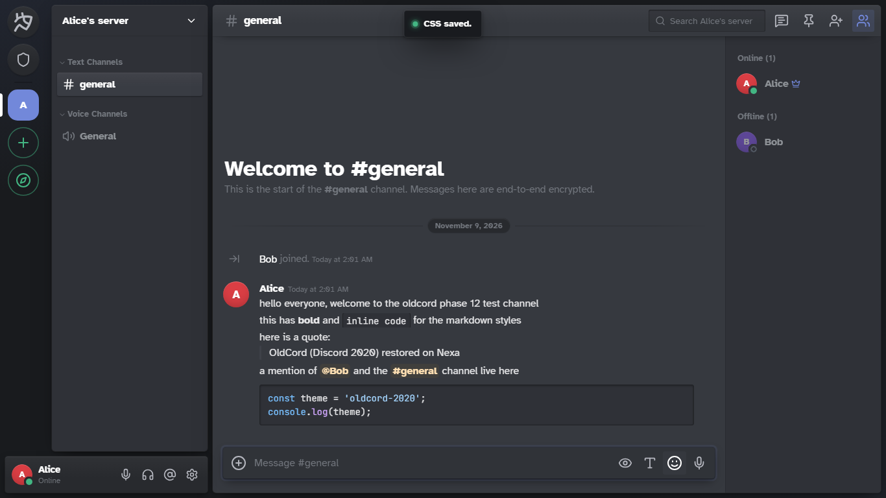

# Oldcord for Nexa

**Discord, as it looked in 2020 — on Nexa.** A single-file CSS theme that ports the
OldCord visual language (milbits/oldcord v2.1, MIT) onto Nexa's official
**Custom CSS** system. No code changes to Nexa are required: it installs as a
"Theme from a Link" or a pasted Snippet and styles the whole app with one file.

## Reference
Discord circa 2020 (the visual era OldCord restores): flat dark grey
surfaces `#36393F / #2F3136 / #292B2F / #202225 / #18191C`, **blurple
`hsl(227 58% 65%)` = `#7288DA`** (Discord's 2020 blurple — not the 2021
`#5865F2`), channel names `#8E9297`, muted text `#72767D`, white
interactive text, github-dark code palette, 2–5 px corners, 48 px server
tiles with a 16 px hover / 15 px selected radius morph, and the 72 / 240 /
48 px rail–sidebar–header geometry. Whitney is not bundled (license), so
the shipped fallback is Atkinson Hyperlegible + Twemoji Text, exactly as
Nexa's own docs suggest. Optional Google Fonts `@import` at the top of
`oldcord.css` (delete it for zero external requests).

## What it changes
Everything rides on Nexa's 61 official theme tokens plus the Sass-variables:
surfaces, hover/selection, mentions (amber 2020 wash + 2 px bar), code
colors, borders, status colors, radii, and the layout constants above —
so a preset Dark/Ash theme becomes OldCord with one paste. Selected sidebar
glyphs turn white, embeds get the 2020 `#4F545C` bar, profile cards get the
classic `#2F3136` shell and `#292B2F` sheet **unless the user has chosen
their own profile colors** — Nexa's per-user profile gradients, single
accent colors, banner images, avatar tints and role colors are preserved
(V1.1.0+), reaction pills go square, menus use OldCord's
`brand-experiment-560` hover.

## Install
Use **`oldcord.css`** (25,631 B — well under Nexa's 64 KB snippet and 1 MB
link limits).

### Option A — Themes from Links (recommended)
1. Host `oldcord.css` over HTTPS. Once this repository is published, the raw
   file URL is the standard way to host it:
   `https://raw.githubusercontent.com/afterintimacy/oldcord-for-nexa/main/oldcord.css`
   (that is this project's file; re-host a pinned copy if you want an
   immutable version instead of tracking `main`).
2. In Nexa: **Settings → Custom CSS → Themes from Links → Add a Link**,
   paste the URL, toggle it on for that device.
3. In **Settings → Appearance** pick **Dark** (or any dark preset).
   OldCord is dark-only; under a Light preset the stylesheet stays inert
   by design instead of producing a hybrid.

### Option B — Snippet (paste)
1. **Settings → Custom CSS** → open the editor.
2. Paste the whole contents of `oldcord.css`.
3. **Save CSS**. The whole app changes immediately; snippets sync
   across your devices.

## Disable / uninstall
- Toggle **Use my CSS** off in Settings → Custom CSS (one switch, keeps
  the snippet text), or
- unpublish the link under **Themes from Links**, or
- open Nexa with `?safe` at the end of the address (Custom CSS and
  plugins are off for that tab, so you can fix or remove the entry).

No data is lost in any of these: the theme only paints, it never stores
anything of its own.

## Update
- **Themes from Links**: Nexa re-fetches links daily; use **Refresh** in
  Settings → Custom CSS to get a new version at once.
- **Snippet**: re-paste the latest `oldcord.css` contents and Save.

## Compatibility
| Platform | Supported |
| --- | --- |
| Nexa Web (browser) | ✅ (the only supported platform for this release) |

Supported platform for this release: **Nexa Web only.**
Some development history in `docs/` mentions other platforms; those
entries describe internal test evidence from a non-public dev
environment — **not** compatibility promises. Custom CSS is the
installation mechanism on Nexa Web, and the theme file is plain CSS.

## Known limitations
- Dark-only: under a Light preset the stylesheet stays inert (by design).
- Some modern Discord/Nexa screens have no 2020 equivalent (Lottie
  animations, voice-stage quirks) — those keep Nexa's own rendering.
- Whitney substitute is typographically close, not identical.
- A profile with **no custom colors and no banner** gets Nexa's own
  deterministic per-user banner color (`avatarColor`): pure CSS cannot
  tell it apart from a user's single chosen accent (both are inline styles
  on the banner), so OldCord preserves Nexa's banner — see
  `docs/IMPLEMENTATION.md` § Profile color adaptation.

## What's new in V1.2.0

V1.2.0 adds two component rules (no token changes, no selectors
outside settings/tooltip/picker) on top of V1.1.0.

- **T1 — settings shell:** the settings layer's `radial-gradient`
  `--canvas-glow` wash (13% of brand) is flattened to `--bg-base`
  (`#2F3136`), giving the classic two-tone 2020 settings shell.
  Scoped to `[data-modal-layer]:has(> [class*="_navWrap_"],
  > [class*="_contentWrap_"])` only; every control keeps its token.
- **T2 — tooltip:** `Tooltip.tsx` writes `--tooltip-bg` inline per
  bubble, so the theme token never reached it (measured `rgb(27,25,36)`
  under V1.1.0). V1.2.0 re-asserts `--tooltip-bg: #000 !important` on
  the bubble; the component's own background/arrow rules then render
  the classic black 2020 tooltip with white text (measured
  `rgb(0,0,0)`).
- **T3 — picker radius:** verified correct at 8 px (the OldCord 2020
  reference uses 8 px; the Phase 17 proposal of 4 px was not
  implemented). No change — the picker retains its original 8px radius.

CSS budget: +2 rules, +2,126 B (25,631 B total — under the 64 KB
snippet and 1 MB link limits).

## Report an issue
Open an issue in this repository with:
1. The `oldcord.css` version/commit you installed,
2. browser (and OS) version,
3. a screenshot of the broken state,
4. whether it reproduces with and without the theme.

## License
MIT — see `LICENSE`. Based on milbits/oldcord (MIT); the OldCord/Discord
logos and third-party artwork in the original were **not** redistributed
and are documented in `docs/LICENSES.md`.
